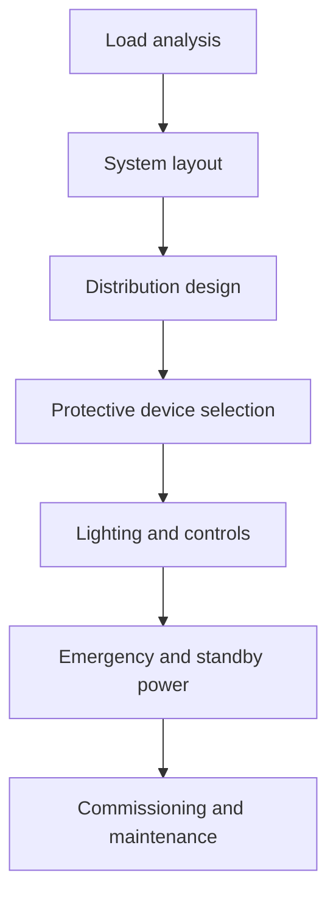

# Commercial Electrical Engineering

Commercial electrical engineering addresses larger and more complex building systems than residential design. It covers distribution, lighting, protection, backup power, and coordinated infrastructure across offices, retail, campuses, healthcare, and mixed-use facilities.

## Core topics

- distribution systems and feeder design
- switchgear, panelboards, and transformers
- lighting layouts and controls
- emergency systems and life safety power
- grounding and fault protection
- UPS and standby generation
- building code coordination

## Why it matters

Commercial facilities carry higher loads, more diverse occupancy needs, and stricter reliability requirements. Commercial electrical systems must support continuity, safety, and operational flexibility.

## Common system components

- service transformers and utility interfaces
- main switchboards and subpanels
- branch distribution networks
- emergency and essential load panels
- lighting control systems
- fire alarm and life safety interfaces

## Commercial design flow

## Reference links

- [Electrical Contractors](https://www.ecmag.com/)
- [ASHRAE and building systems guidance](https://www.ashrae.org/)
- [NFPA life safety and electrical standards](https://www.nfpa.org/)

## Summary

Commercial electrical engineering is about building resilient infrastructure that supports people, operations, and safety in larger occupancies. It blends power distribution, controls, and code-driven reliability planning.
