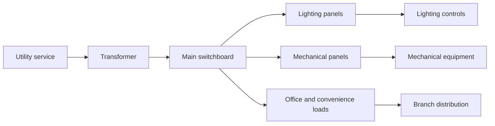

# Commercial Distribution and Lighting

Commercial electrical design emphasizes the coordinated delivery of power and illumination across a building. It requires careful planning for loads, safety, continuity, and energy efficiency.

## Main design areas

### Distribution design

Commercial systems often include:

- primary or secondary utility service
- switchboards and panelboards
- feeder sizing and voltage drop checks
- grounding and fault coordination
- selective protection schemes

### Lighting design

Lighting is a major system component in commercial facilities. It includes:

- ambient, task, and emergency lighting
- occupancy sensors and scheduling
- daylighting strategies
- fixture selection and power budgeting
- lighting controls for efficiency and code compliance

## Key performance considerations

- occupant comfort
- energy use intensity
- emergency life safety coverage
- maintenance access
- visual tasks and productivity

## System illustration

## Summary

Commercial distribution and lighting design balances capacity, code compliance, comfort, and energy efficiency while supporting the operational needs of larger facilities.
