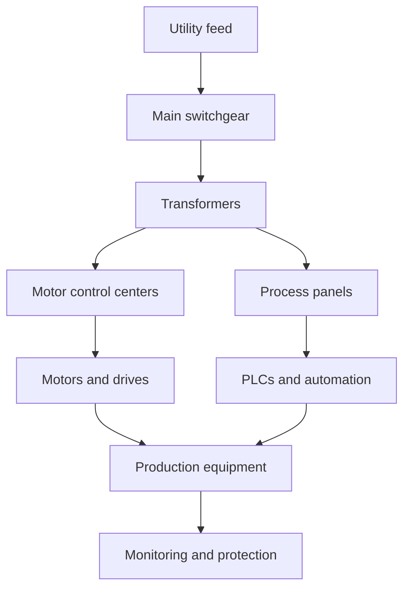

# Industrial Electrical Engineering

Industrial electrical engineering covers the power and control systems required by factories, plants, machinery, and process operations. It is highly focused on reliability, power quality, automation, and safe integration of large equipment.

## Key domains

- motor control centers
- transformers and switchgear
- variable frequency drives
- distribution and grounding
- process instrumentation and PLC systems
- backup power and fault protection

## Why it matters

Industrial environments demand robust, fault-tolerant systems because downtime can disrupt production, safety, and revenue. Reliability is often more important than maximum efficiency alone.

## Industrial system model

## Reference links

- [IEEE Industry Applications Society](https://ias.ieee.org/)
- [NEMA electrical standards](https://www.nema.org/)
- [AutomationDirect technical references](https://www.automationdirect.com/)

## Summary

Industrial electrical engineering is about designing resilient systems for heavy-duty operation, automation, and process continuity under demanding conditions.
