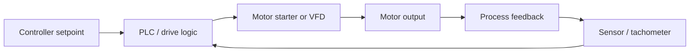

# Motors and Industrial Controls

Industrial electrical systems depend heavily on motors, drives, and control logic. This path covers how electric machines convert electrical energy into mechanical work and how automated systems manage that conversion reliably.

## Key concepts

- induction motors
- synchronous machines
- variable-frequency drives
- contactors and relays
- overload protection
- PLC and ladder logic
- motor starting and braking

## Why it matters

Motors are among the highest-energy consumers in industrial facilities. Efficient control of motor operation directly affects productivity, energy use, and mechanical reliability.

## Example control loop

## Summary

Industrial motion control is where electrical design intersects with process engineering. The challenge is not just delivering power, but delivering it predictably and safely under demanding operating conditions.
