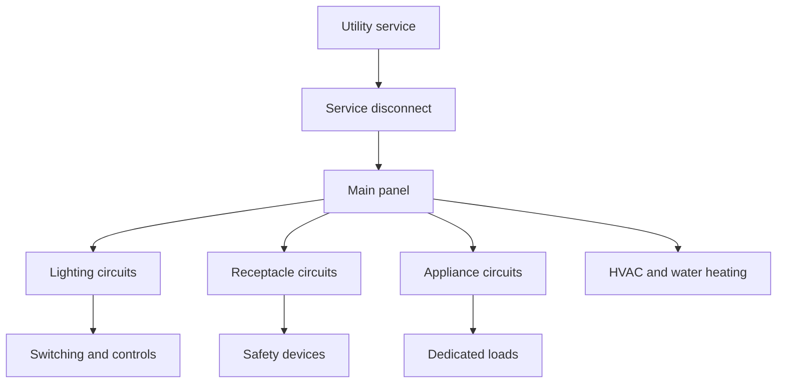

# Residential Electrical Engineering

Residential electrical engineering focuses on the safe and efficient delivery of power and lighting to homes. It sits at the intersection of building systems, safety, load analysis, installation practices, and everyday electrical service.

## Core topics

- service entrance and metering
- branch circuits and panelboards
- grounding and bonding
- lighting design and controls
- receptacle placement and demand planning
- surge protection and standby power
- code compliance and safety procedures

## Why it matters

Residential systems are the most direct interface between infrastructure and daily life. Good design ensures reliability, safety, energy efficiency, and long-term maintainability.

## Learning path

### Fundamentals

- voltage, current, and power in AC circuits
- conductors, insulation, and overcurrent protection
- single-phase residential distribution
- load calculations and demand factors

### Practical design

- service sizing and panel layout
- lighting circuits and switching methods
- GFCI and AFCI protection
- appliance circuits and dedicated loads
- energy-efficient lighting and automation

## Residential system overview

## Reference links

- [National Electrical Code (NEC)](https://www.nfpa.org/)
- [Electrical Safety Foundation International](https://www.esfi.org/)
- [HomeAdvisor Electrical Guide](https://www.homeadvisor.com/r/electrical/)

## Summary

Residential electrical engineering is where theory becomes practical service design. It emphasizes user safety, code-based installation, stable operation, and efficient everyday power delivery.
