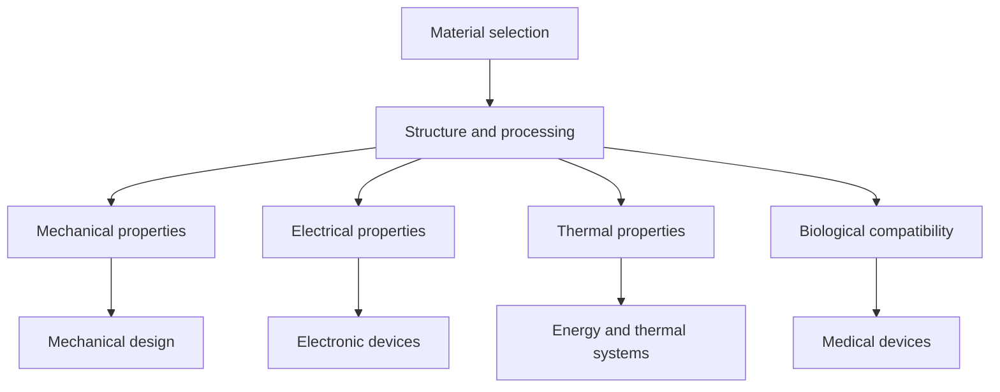

# Materials Engineering

Materials engineering studies how structure, processing, and composition determine a material's properties and performance in real systems. It sits at the center of nearly every other engineering discipline because materials determine what is possible in electronics, mechanical design, biomedical devices, energy systems, and manufacturing.

This section is organized as a practical learning map rather than a narrow research index. It links the core materials areas that connect to the larger engineering system.

## Core domains

- [Nanomaterials and Nanofabrication](Nano/README.md): nanoscale structures, fabrication methods, optics, and micro/nano processing
- [Textiles](Textiles/README.md): fibers, composites, polymer systems, and textile performance

## Why this matters

Materials choices shape:

- mechanical strength and flexibility
- thermal behavior and durability
- electrical conductivity and insulation
- biocompatibility and medical performance
- energy efficiency and device reliability

## Related engineering domains

- [Electrical Engineering](../Electrical/README.md): semiconductors, conductive materials, devices, and power systems
- [Mechanical Engineering](../Mechanical/README.md): structural materials, wear, fatigue, and manufacturing
- [Medical Engineering](../Medical/README.md): biomaterials, implants, tissue interfaces, and diagnostics
- [Nuclear Engineering](../Nuclear/README.md): radiation-tolerant materials and fuel-cycle materials

## Learning path

### Foundations

- atomic structure and bonding
- crystal structure and defects
- phase behavior and thermodynamics
- stress, strain, and mechanical response

### Applied materials

- polymers and composites
- semiconductors and electronic materials
- coatings and surface engineering
- biomaterials and medical interfaces

### Advanced topics

- nanomaterials and fabrication
- materials characterization
- reliability and failure analysis
- sustainable and high-performance materials

## Material-performance map

## Featured resources

- [Advanced Optical Materials](https://advanced.onlinelibrary.wiley.com/journal/21951071)
- [Light-Responsive Materials in Droplet Manipulation for Biochemical Applications](https://advanced.onlinelibrary.wiley.com/doi/epdf/10.1002/adma.202313935)
- [Huygens Optics](https://www.youtube.com/@HuygensOptics/videos)

## Research hubs and journals

- [Google Scholar](https://scholar.google.com/)
- [Google Research](https://research.google/)
- [Acta Materialia](https://www.sciencedirect.com/journal/acta-materialia)
- [Advanced Materials](https://onlinelibrary.wiley.com/journal/15214095)
- [Nature Materials](https://www.nature.com/nmat/)
- [ACS Applied Materials & Interfaces](https://pubs.acs.org/journal/aamick)
- [Journal of Materials Science](https://link.springer.com/journal/10853)
- [Advanced Functional Materials](https://onlinelibrary.wiley.com/journal/16163028)
- [Harvard Dataverse](https://dataverse.harvard.edu/)
- [Dryad](https://datadryad.org/)
- [arXiv](https://arxiv.org/)

## Licenses, certifications, and compliance standards

- [ASM International](https://www.asminternational.org/)
- [NACE International](https://www.nace.org/)
- [ASTM International Standards](https://www.astm.org/)
- [ISO Standards](https://www.iso.org/standards.html)
- [ISO 6892 Metallic Materials Tensile Testing](https://www.iso.org/standard/80886.html)
- [ISO 10993 Biological Evaluation of Medical Devices](https://www.iso.org/standard/68936.html)
- [ASTM E8/E8M Tensile Testing of Metals](https://www.astm.org/e0008_e0008m-24.html)
- [ASME Material Standards](https://www.asme.org/codes-standards)
- [NIST Materials Measurement Laboratory](https://www.nist.gov/mml)

## Summary

Materials engineering is the backbone of all applied engineering because it defines the physical limits and performance envelope of every device, structure, and system. It connects directly to electrical, mechanical, biomedical, and energy engineering.
