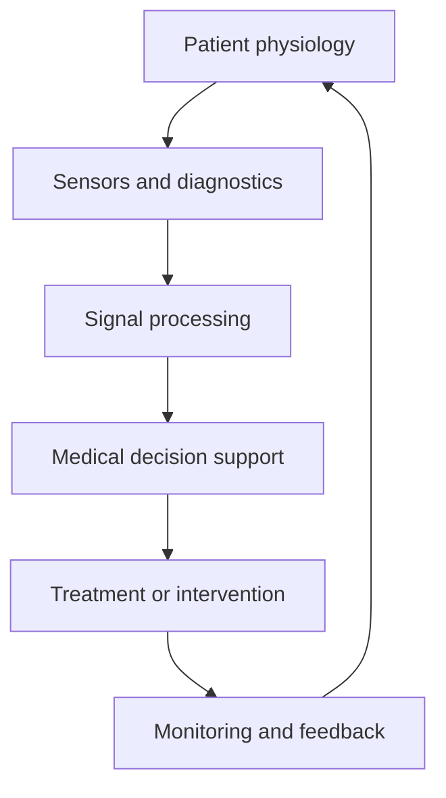

# Biomedical and Medical Engineering

Medical engineering applies engineering principles to biology, health, disease detection, care delivery, and human systems. It sits at the intersection of physics, electronics, materials, computation, and clinical practice.

This section is a learning map that connects the technical and applied sides of the field: diagnostics, instrumentation, neural systems, biotechnology, and human-centered device design.

## Major branches

- [Biotechnology](BioTechnology/README.md): tools, molecular methods, biological systems, and translational research
- [Neural Engineering](Neural/README.md): neural interfaces, measurement systems, neurotechnology, and signal interpretation

## Related domains

- [Electrical Engineering](../Electrical/README.md): instrumentation, signal acquisition, sensors, and medical device electronics
- [Robotics](../Robotics/README.md): assistive robotics, surgical systems, and intelligent clinical devices
- [Materials Engineering](../Materials/README.md): biomaterials, implants, prosthetics, and device packaging
- [Network Engineering](../Network/README.md): connected medical systems, telemetry, and distributed monitoring

## Why this field matters

Medical engineering improves diagnosis, treatment, monitoring, and patient outcomes through engineering design. It spans:

- imaging and diagnostic tools
- wearable and implantable devices
- biosensors and physiological monitoring
- rehabilitation and assistive technologies
- neural interfaces and brain-computer systems

## Learning path

### Foundations

- physiology and human systems
- signal processing and instrumentation
- biomechanics and materials behavior
- statistics and medical data interpretation

### Applied systems

- medical imaging and sensing
- therapeutic and diagnostic devices
- bioinformatics and clinical data workflows
- reliability, safety, and regulatory constraints

### Advanced topics

- neural engineering and brain interfaces
- implantable devices and closed-loop systems
- digital health and connected medical systems
- translational engineering and clinical validation

## Medical systems overview

## Core resources

- [Lampe Joint](https://bme.unc.edu/)
- [MAXQDA](https://www.maxqda.com/)
- [CLC Genomics](https://digitalinsights.qiagen.com/)
- [SnapGene](https://www.snapgene.com/)
- [IRB](https://ori.hhs.gov/content/chapter-3-The-Protection-of-Human-Subjects-IRBs)

## Research hubs and journals

- [Google Scholar](https://scholar.google.com/)
- [Google Research](https://research.google/)
- [IEEE Xplore](https://ieeexplore.ieee.org/)
- [IEEE Transactions on Biomedical Engineering](https://ieeexplore.ieee.org/xpl/RecentIssue.jsp?punumber=10)
- [IEEE Journal of Biomedical and Health Informatics](https://ieeexplore.ieee.org/xpl/RecentIssue.jsp?punumber=6221020)
- [Nature Biomedical Engineering](https://www.nature.com/nbioeng/)
- [npj Digital Medicine](https://www.nature.com/npjdigitalmed/)
- [Biomedical Signal Processing and Control](https://www.sciencedirect.com/journal/biomedical-signal-processing-and-control)
- [PubMed](https://pubmed.ncbi.nlm.nih.gov/)
- [Harvard Dataverse](https://dataverse.harvard.edu/)
- [Dryad](https://datadryad.org/)
- [arXiv](https://arxiv.org/)

## Licenses, certifications, and compliance standards

- [FDA Medical Device Regulation](https://www.fda.gov/medical-devices)
- [FDA 510(k) Program](https://www.fda.gov/medical-devices/premarkarket-submissions-selecting-and-preparing/510k-clearances)
- [FDA PMA Program](https://www.fda.gov/medical-devices/premarkarket-submissions-selecting-and-preparing/premarkarket-approval-pma)
- [ISO 13485 Medical Devices Quality Management](https://www.iso.org/standard/59752.html)
- [IEC 60601 Medical Electrical Equipment Safety](https://webstore.iec.ch/publication/32849)
- [IEC 62304 Software Lifecycle for Medical Devices](https://webstore.iec.ch/publication/65056)
- [IEC 62366 Usability Engineering for Medical Devices](https://webstore.iec.ch/publication/24572)
- [HIPAA Privacy and Security](https://www.hhs.gov/hipaa/index.html)
- [GxP and regulated clinical data practices](https://www.fda.gov/inspections-compliance-enforcement-and-criminal-investigations/inspectors-guides)

## Summary

Medical engineering is a systems-oriented discipline that translates scientific understanding into tools for human health. It blends biology, instrumentation, device design, and clinical ethics into one integrated engineering practice.