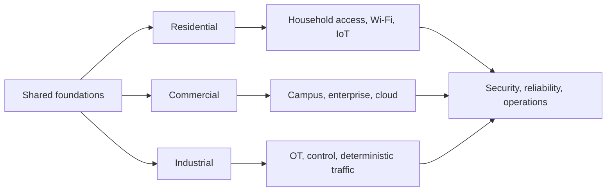
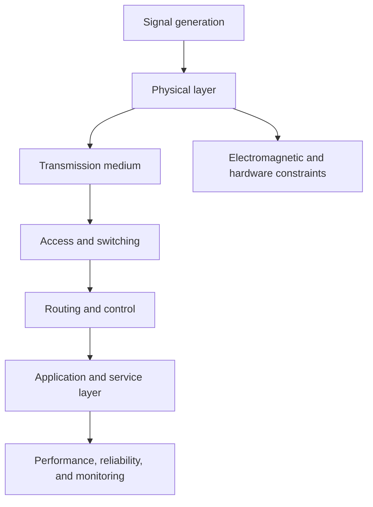

# Network Engineering

Network engineering is the discipline concerned with how information is transmitted, switched, routed, and managed across systems. It builds directly on electrical engineering foundations such as signal propagation, electromagnetic behavior, modulation, transmission media, and communications hardware.

This section is designed to work alongside the electrical engineering track rather than as a separate silo. Electrical engineering supplies the physical layer and device-level foundations; network engineering focuses on architecture, traffic flow, protocols, reliability, and system-level connectivity.

## Core themes

- communications systems and signal transport
- network architecture and topology
- wireless systems, spectrum, and propagation
- switching, routing, and protocol stacks
- reliability, latency, and capacity planning
- next-generation network design and intelligent infrastructure

## Related domains

- [Electrical Engineering](../Electrical/README.md): power, circuits, signals, electromagnetics, electronics, and control foundations
- [Communications](../Electrical/communications.md): modulation, signal flow, noise, bandwidth, and communications theory
- [Signals and Systems](../Electrical/signals-and-systems.md): time-domain and frequency-domain analysis

## Applied network engineering

Network design changes with the people, services, safety needs, and operating conditions of each environment. These three tracks provide practical entry points into the discipline:

- [Residential networking](residential/README.md): home internet access, Wi-Fi coverage, wired Ethernet, connected devices, privacy, and resilient home services
- [Commercial networking](commercial/README.md): office and campus LANs, structured cabling, business Wi-Fi, identity-based access, voice/video, cloud connectivity, and service continuity
- [Industrial networking](industrial/README.md): operational technology (OT), industrial Ethernet, PLC and SCADA connectivity, deterministic communication, segmentation, and safety-aware operations

### Residential networks

Residential networks serve households and home offices, balancing ease of use, reliable coverage, affordability, and protection of personal devices. Study access equipment, router and access-point placement, Ethernet backhaul, guest and IoT segmentation, parental controls, and backup connectivity.

### Commercial networks

Commercial networks support organizations, employees, visitors, facilities, and business-critical applications. Study requirements gathering, structured cabling, redundant switching and routing, managed wireless, identity and access policy, voice and video quality, monitoring, and change management.

### Industrial networks

Industrial networks connect control systems and operational assets where timing, availability, safety, and equipment lifetime can be more important than general-purpose throughput. Study industrial Ethernet, fieldbus integration, PLC and SCADA communication, OT/IT boundaries, network segmentation, time synchronization, redundancy, and safe maintenance practices.

## Learning path

### Foundations

- circuit and signal fundamentals
- electromagnetic wave propagation
- channel capacity and noise
- modulation and coding

### System design

- network topologies and traffic models
- routing, switching, and latency management
- wireless access and spectrum planning
- network performance and resilience

### Advanced topics

- 5G/6G and next-generation wireless systems
- edge and distributed network architectures
- Internet-scale systems and network optimization
- intelligent network management and automation

## Network system overview

## Research hubs and journals

- [Google Scholar](https://scholar.google.com/)
- [Google Research](https://research.google/)
- [IEEE Xplore](https://ieeexplore.ieee.org/)
- [IEEE/ACM Transactions on Networking](https://dl.acm.org/journal/ton)
- [IEEE Journal on Selected Areas in Communications](https://ieeexplore.ieee.org/xpl/RecentIssue.jsp?punumber=49)
- [IEEE Transactions on Wireless Communications](https://ieeexplore.ieee.org/xpl/RecentIssue.jsp?punumber=7693)
- [ACM SIGCOMM](https://dl.acm.org/sig/sigcomm)
- [Computer Networks](https://www.sciencedirect.com/journal/computer-networks)
- [Nature Communications](https://www.nature.com/ncomms/)
- [Harvard Dataverse](https://dataverse.harvard.edu/)
- [Dryad](https://datadryad.org/)
- [arXiv](https://arxiv.org/)

## Licenses, certifications, and compliance standards

- [Cisco Certifications](https://www.cisco.com/c/en/us/training-events/training-certifications.html)
- [CompTIA Network+](https://www.comptia.org/certifications/network)
- [Juniper Networks Certifications](https://www.juniper.net/us/en/training-certification/)
- [IEEE Standards](https://standards.ieee.org/)
- [ISO/IEC 27001 Information Security Management](https://www.iso.org/standard/27001)
- [ISO/IEC 11801 Generic Cabling for Customer Premises](https://www.iso.org/standard/73933.html)
- [TIA-568 Structured Cabling Standards](https://www.tiaonline.org/standards/)
- [ETSI Standards](https://www.etsi.org/standards)
- [3GPP Standards](https://www.3gpp.org/specifications)
- [NIST Cybersecurity Framework](https://www.nist.gov/cyberframework)

## Summary

Network engineering is the communication layer that turns electrical and signal-level phenomena into usable, connected systems. It complements electrical engineering by focusing on the structure, movement, and intelligence of digital communication across networks.