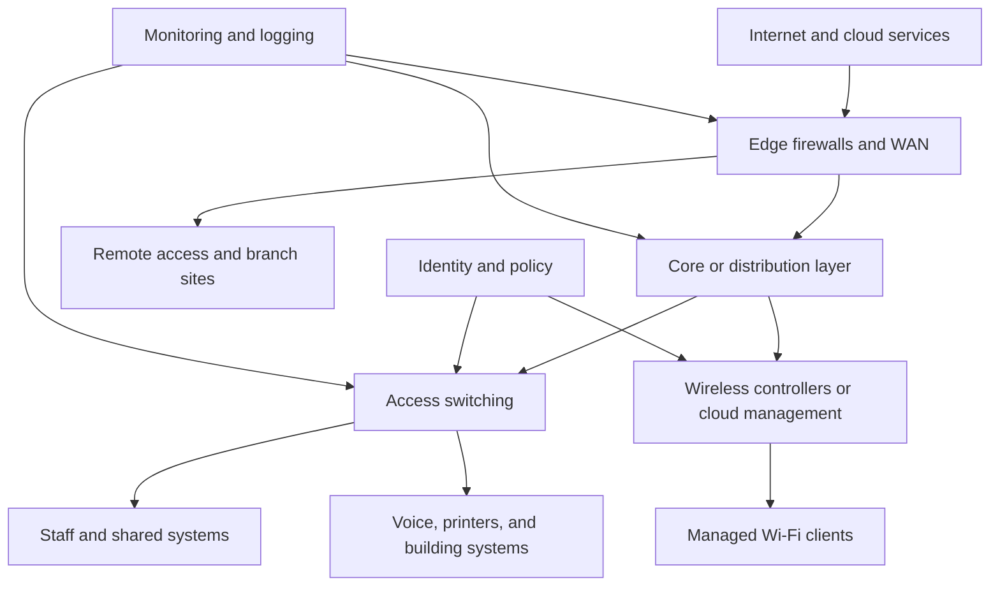

# Commercial Network Engineering

Commercial network engineering designs connectivity for offices, campuses, retail, hospitality, healthcare, education, and other organizations. It must support many user groups and applications while meeting requirements for availability, security, performance, growth, and operational control.

## Core topics

- requirements gathering, site surveys, and high-level architecture
- structured copper and fiber cabling, pathways, and labeling
- campus LAN design, VLANs, switching, and routed access
- enterprise Wi-Fi, roaming, density, and radio-frequency planning
- WAN, internet, cloud, and branch connectivity
- identity-aware access control, NAC, and network segmentation
- voice, video conferencing, collaboration, and QoS
- firewalls, VPNs, logging, monitoring, and configuration management
- high availability, disaster recovery, and lifecycle planning

## Why it matters

Organizations rely on connectivity for business processes, customer service, collaboration, facilities, and access to cloud applications. Commercial networks must accommodate different trust levels and service needs without turning every change or outage into an organization-wide disruption.

## Learning path

### Foundations

- Ethernet switching, VLANs, trunking, and spanning-tree concepts
- IPv4/IPv6 addressing, subnetting, routing, and DNS/DHCP services
- wireless coverage, capacity, roaming, and interference
- structured cabling, fiber basics, and physical-layer testing

### Architecture and deployment

- translate business requirements into bandwidth, availability, and security goals
- survey sites and document pathways, racks, power, and radio conditions
- design hierarchical campus networks and resilient uplinks
- define segmentation and access policy for staff, guests, devices, and facilities
- plan WAN and cloud connectivity, including failover paths
- validate performance and security through staged testing and commissioning

### Operations and governance

- maintain asset, topology, addressing, and configuration records
- monitor availability, utilization, errors, wireless health, and security events
- use controlled change processes, backups, and rollback plans
- test recovery assumptions and review capacity as organizations grow

## Commercial network overview

## Design checklist

- Classify users, devices, applications, and data by business criticality and trust.
- Document physical site constraints, carrier handoffs, power, cooling, and cabling routes.
- Design address plans and routing boundaries that can scale across sites.
- Provide redundancy for critical links and equipment where the availability target requires it.
- Plan separate policy zones for guests, employees, servers, voice, facilities, and management.
- Validate wireless capacity and roaming with representative client devices and real occupancy.
- Include monitoring, configuration backup, time synchronization, and secure management access.
- Define acceptance tests, change ownership, documentation, and recovery procedures.

## Standards, frameworks, and certifications

- [IEEE 802 LAN/MAN standards](https://standards.ieee.org/ieee/802/)
- [TIA standards](https://www.tiaonline.org/standards/), including structured cabling families such as TIA-568
- [ISO/IEC 11801 Generic Cabling for Customer Premises](https://www.iso.org/standard/73933.html)
- [IETF RFC Editor](https://www.rfc-editor.org/)
- [NIST Cybersecurity Framework](https://www.nist.gov/cyberframework)
- [ISO/IEC 27001 Information Security Management](https://www.iso.org/standard/27001)
- [Cisco Certifications](https://www.cisco.com/c/en/us/training-events/training-certifications.html)
- [Juniper Networks Certification](https://www.juniper.net/us/en/training-certification/)
- [CompTIA Network+](https://www.comptia.org/certifications/network)
- [BICSI credentials and education](https://www.bicsi.org/education-certification)

Standards and regulatory obligations depend on the facility, industry, country, and data handled. Verify current editions and requirements with the relevant authorities and qualified professionals; certifications demonstrate a body of knowledge but do not replace local authorization or professional licensure.

## Related tracks

- [Residential Network Engineering](../residential/README.md)
- [Industrial Network Engineering](../industrial/README.md)
- [Electrical Engineering](../../Electrical/README.md)

## Summary

Commercial network engineering combines physical infrastructure, enterprise services, security policy, and operational practice. Its central challenge is to deliver consistent service across users, buildings, and applications while making failures containable and changes supportable.
