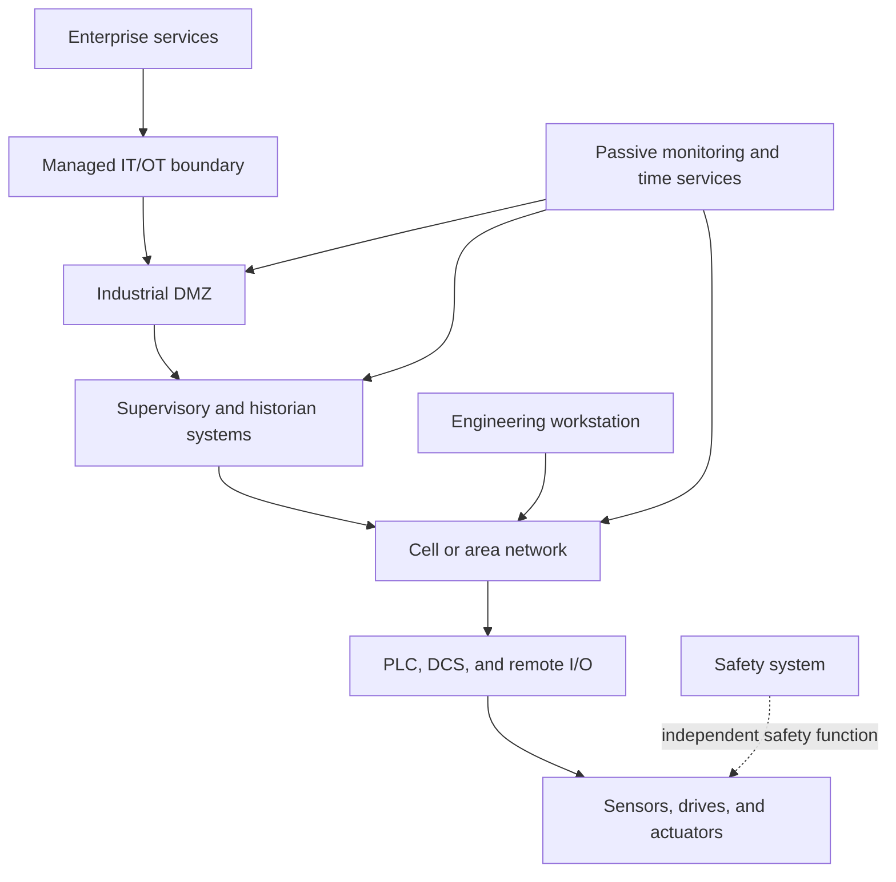

# Industrial Network Engineering

Industrial network engineering designs and operates communication systems for operational technology (OT), manufacturing, utilities, transportation, process facilities, and other environments where networks connect physical processes. It links controllers, sensors, actuators, operator stations, historians, and enterprise services while respecting availability, timing, safety, and equipment-lifecycle constraints.

## Core topics

- industrial Ethernet and fieldbus integration
- PLC, DCS, SCADA, HMI, historian, and engineering-workstation communication
- cell/area zones, conduits, and OT/IT boundary design
- deterministic and time-sensitive communication
- industrial wireless, remote telemetry, and constrained links
- network redundancy, recovery, and time synchronization
- asset inventory, passive monitoring, and anomaly detection
- secure remote access, change control, and incident response
- safety instrumented systems and separation of safety functions

## Why it matters

Industrial networks influence the visibility and coordination of physical operations. A network failure, unsafe change, or poorly controlled connection can affect production, equipment, environmental controls, or human safety. Engineering decisions must therefore account for process hazards, operational windows, legacy systems, and the consequences of degraded or lost communication.

## Learning path

### Foundations

- review Ethernet, IP, switching, routing, and network troubleshooting
- learn PLC, DCS, SCADA, HMI, and instrumentation roles
- distinguish information technology (IT) from operational technology (OT)
- study latency, jitter, packet loss, availability, and time synchronization

### Architecture and integration

- identify assets, process dependencies, communication paths, and owners
- define zones and controlled conduits between systems
- segment safety, control, supervisory, and enterprise functions appropriately
- select industrial Ethernet or fieldbus technologies based on validated requirements
- account for redundancy, environmental conditions, lifecycle, and vendor support
- design remote access around authorization, monitoring, and time-bounded need

### Operations and risk management

- maintain passive asset inventories and approved network diagrams
- coordinate changes with process owners and site safety procedures
- test recovery and failover in an authorized, controlled environment
- preserve incident records, configurations, and recovery documentation
- assess security changes for effects on availability and process behavior

## Industrial network overview

## Design and safety checklist

- Begin with process context, hazard analysis, asset ownership, and approved operating procedures.
- Map required communication flows before selecting segmentation or firewall rules.
- Use defense-in-depth and controlled conduits; do not assume an air gap guarantees security.
- Preserve safety-system independence and follow the site’s functional-safety requirements.
- Prefer passive discovery and monitoring where active scans could disrupt fragile devices.
- Verify protocol, firmware, redundancy, timing, and environmental requirements with asset vendors.
- Schedule testing and changes with operations personnel; define stop, rollback, and recovery criteria.
- Do not experiment on live control networks or change production configurations without explicit authorization.

## Standards, frameworks, and certifications

- [IEC 62443 Industrial communication networks - Network and system security](https://www.iec.ch/cyber-security)
- [ISA/IEC 62443 overview and training](https://www.isa.org/standards-and-publications/isa-standards/isa-iec-62443-series-of-standards)
- [NIST SP 800-82 Guide to Operational Technology Security](https://csrc.nist.gov/pubs/sp/800/82/r3/final)
- [NIST Cybersecurity Framework](https://www.nist.gov/cyberframework)
- [IEEE 802 standards](https://standards.ieee.org/ieee/802/)
- [ODVA technologies and specifications](https://www.odva.org/)
- [PROFIBUS and PROFINET International](https://www.profibus.com/)
- [ISA/IEC 62443 certificate programs](https://www.isa.org/certification)
- [GIAC Global Industrial Cyber Security Professional (GICSP)](https://www.giac.org/certifications/global-industrial-cyber-security-professional-gicsp/)

Standards applicability varies by industry and jurisdiction. IEC 62443 is a family of standards with multiple parts, not a single blanket certification; verify the applicable part, edition, sector rules, and site requirements with qualified OT, cybersecurity, and safety professionals.

## Related tracks

- [Residential Network Engineering](../residential/README.md)
- [Commercial Network Engineering](../commercial/README.md)
- [Electrical Engineering](../../Electrical/README.md)
- [Nuclear Engineering](../../Nuclear/README.md)

## Summary

Industrial network engineering connects digital communication to real processes. It requires a systems view in which connectivity, cybersecurity, availability, timing, operational safety, and human authorization are designed together.
