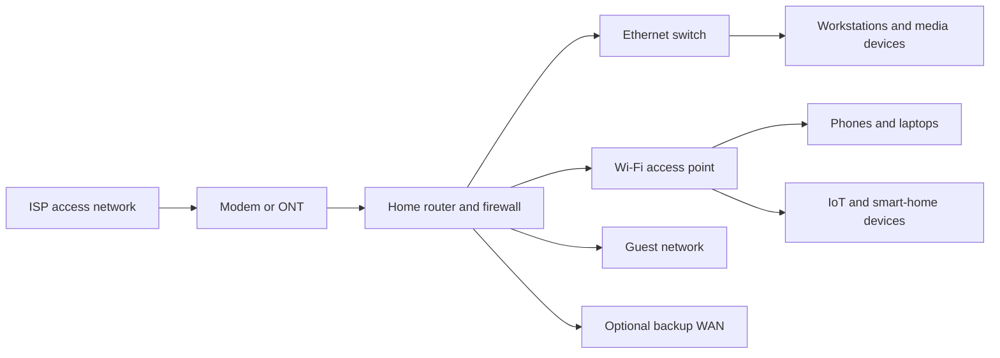

# Residential Network Engineering

Residential network engineering designs the connections used by households and home offices. It brings internet access, wired Ethernet, Wi-Fi, voice, entertainment, security, and smart-home devices together while balancing coverage, cost, privacy, ease of use, and maintainability.

## Core topics

- broadband access technologies and service demarcation
- home routers, gateways, switches, and access points
- Wi-Fi coverage, channel planning, roaming, and interference
- Ethernet cabling and wired backhaul
- guest, work, personal, and smart-home device segmentation
- DNS, DHCP, IPv4/IPv6, and basic firewall policy
- parental controls, privacy, and account security
- backup connectivity, UPS support, and service troubleshooting

## Why it matters

Homes increasingly depend on networks for work, education, communication, entertainment, health, and physical security. A well-designed home network provides dependable access without exposing household devices or making routine maintenance unnecessarily difficult.

## Learning path

### Foundations

- distinguish internet service, local networking, and Wi-Fi
- understand modem/ONT, router, switch, and access-point roles
- learn IP addressing, DHCP, DNS, NAT, and default gateways
- compare Ethernet, fiber, coaxial, and wireless media

### Practical design

- map users, rooms, devices, and service requirements
- place access points based on building materials and coverage needs
- use wired connections for fixed high-demand devices where practical
- separate guest and untrusted IoT devices from trusted endpoints
- use strong unique administrator credentials and supported encryption

### Operations and improvement

- document equipment, network names, and configuration backups
- monitor service availability, coverage, and congestion
- update firmware and retire unsupported devices
- troubleshoot systematically from service handoff toward the client

## Residential network overview

## Design checklist

- Define the provider handoff, expected service rate, and outage needs.
- Identify coverage gaps, dense walls, interference sources, and device locations.
- Prefer wired backhaul for fixed equipment and access points when feasible.
- Keep router administration private; disable unused remote administration and services.
- Use separate guest access and isolate IoT devices where equipment supports it.
- Choose current Wi-Fi security options supported by all required devices.
- Consider IPv6 behavior, DNS privacy, and parental or household access needs.
- Keep a configuration backup and a simple recovery plan for equipment failure.

## Standards and guidance

- [Wi-Fi Alliance](https://www.wi-fi.org/): Wi-Fi technology and certification information
- [IEEE 802.11 Wireless LAN standards](https://standards.ieee.org/ieee/802/802.11.html)
- [IEEE 802.3 Ethernet standards](https://standards.ieee.org/ieee/802/802.3.html)
- [IETF RFC Editor](https://www.rfc-editor.org/): IP, DNS, DHCP, routing, and transport protocol specifications
- [CISA Secure Our World](https://www.cisa.gov/secure-our-world): practical account and device security guidance
- [FCC Broadband Consumer Labels](https://www.fcc.gov/broadbandlabels): consumer-facing broadband plan information in the United States

Standards, equipment capabilities, and local building requirements change. Confirm current editions and applicable jurisdictional requirements before installation; this guide is educational, not a substitute for qualified electrical or construction work.

## Related tracks

- [Commercial Network Engineering](../commercial/README.md)
- [Industrial Network Engineering](../industrial/README.md)
- [Electrical Engineering](../../Electrical/README.md)

## Summary

Residential network engineering turns an internet connection into a usable, secure household service. Strong designs start with the people and devices in the home, then make deliberate choices about coverage, wired capacity, segmentation, privacy, and recovery.
