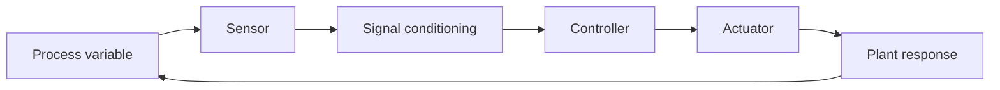

# Instrumentation and Controls

Instrumentation and controls enable safe, stable, and efficient reactor operation. This field combines sensors, signal processing, actuation, logic, and control theory to monitor plant state and maintain required operating conditions.

## Core functions

- measure neutron flux, temperature, pressure, flow, and radiation
- detect abnormalities and transients
- drive control rods, pumps, valves, and safety systems
- maintain system stability and operating limits

## Typical systems

- in-core and ex-core neutron instrumentation
- process instrumentation for coolant and steam systems
- radiation monitors and containment sensors
- protection systems and trip logic
- distributed digital control architectures

## Why it matters

A reactor cannot be safely operated without precise sensing and rapid control. Instrumentation provides the feedback signal; controls determine the corrective action.

## Control loop overview

## Reference links

- [NRC - Instrumentation and Control](https://www.nrc.gov/reactors/operating/training.html)
- [IAEA - Reactor Control and Monitoring](https://www.iaea.org/topics/nuclear-power-reactors)

## Summary

Instrumentation and controls are the nervous system of a nuclear plant. They make safe operation possible by turning raw physical measurements into actionable decisions.
