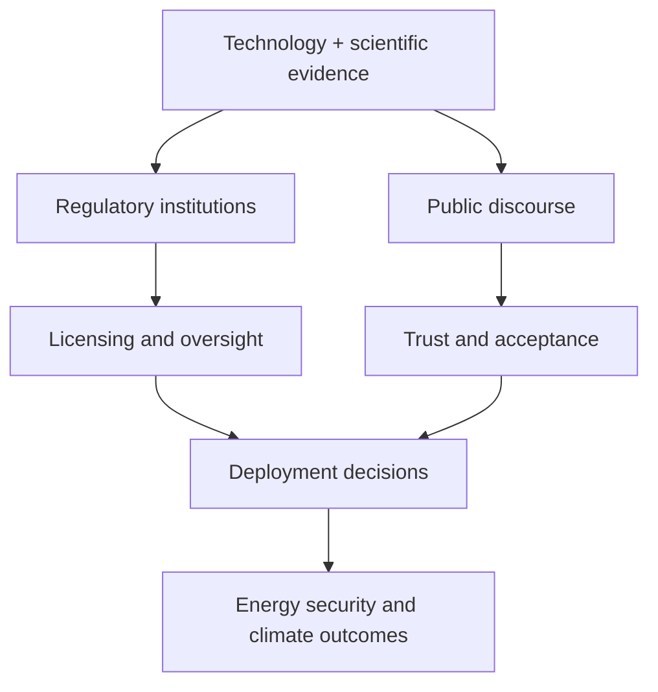

# Nuclear Policy and Society

Nuclear engineering does not exist in isolation from politics, law, ethics, and public trust. This topic addresses how nuclear technology is governed, regulated, financed, and accepted by society.

## Key themes

- energy security and climate policy
- nonproliferation and safeguards
- waste governance and environmental justice
- public communication and trust
- national security and strategic resilience

## Why policy matters

Even a technically excellent reactor design can fail if siting, licensing, financing, or public acceptance are mishandled. Policy shapes deployment timelines, safety expectations, and institutional legitimacy.

## Policy system map

## Reference links

- [IAEA - Nuclear Policy and Governance](https://www.iaea.org/topics/nuclear-policy)
- [World Nuclear Association - Policy and Safety](https://world-nuclear.org/)
- [NRC - Licensing and Oversight](https://www.nrc.gov/)

## Summary

Nuclear policy connects technical design and societal outcomes. It determines whether nuclear systems become trusted infrastructure or contested technology.
