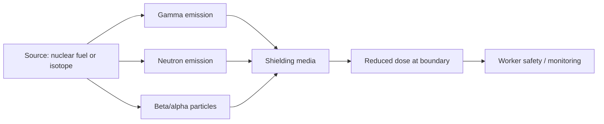

# Radiation Science

Radiation science studies the emission, transport, interaction, and effects of ionizing radiation in matter. It is central to nuclear engineering because radiation is both the source of nuclear power and the main source of risk and protection requirements.

## Why radiation science matters

The nuclear field is defined by its interaction with radiation. Understanding radiation helps engineers design shielding, assess occupational dose, interpret reactor behavior, and manage radioactive materials safely.

## Core topics

### Radioactivity and decay

Radiation originates from unstable nuclei that spontaneously transform by:

- alpha decay
- beta decay
- gamma decay
- neutron emission

### Interaction with matter

Radiation interacts with materials through:

- ionization
- excitation
- scattering
- absorption
- neutron moderation and capture

### Shielding

Shielding design requires selecting materials and thicknesses to reduce dose from:

- gamma rays
- neutron flux
- beta particles
- alpha particles

### Dosimetry and health physics

Dosimetry quantifies exposure and risk. It is essential for occupational safety, site monitoring, and regulatory compliance.

## Radiation field diagram

## Key considerations

- dose and dose rate
- biological effectiveness
- radiation transport
- shielding design
- contamination control
- waste characterization

## Reference links

- [IAEA - Radiation Protection](https://www.iaea.org/topics/radiation-protection)
- [NRC - Radiation Protection](https://www.nrc.gov/about-nrc/radiation.html)
- [WHO - Ionizing Radiation](https://www.who.int/health-topics/ionizing-radiation)

## Summary

Radiation science provides the physical basis for nuclear engineering safety and performance. It explains why shielding, monitoring, and dose management are unavoidable components of any nuclear system.
