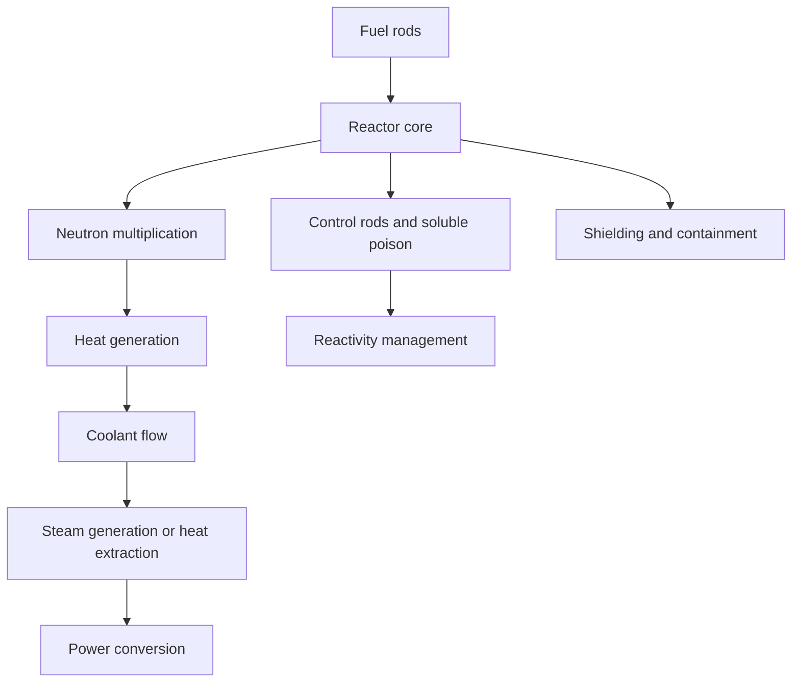

# Reactor Systems

Reactor systems are the core engineering objects of nuclear power: they convert nuclear fission energy into heat, then into electricity or useful process heat. This topic covers reactor types, core design, neutron behavior, thermal hydraulics, and operational design constraints.

## Why reactor systems matter

A reactor is a highly coupled thermal, fluid, materials, and physics system. It must sustain controlled fission while managing neutron economy, heat removal, structural integrity, and safety margins under all steady and transient conditions.

## Core concepts

### Reactor types

- pressurized water reactors (PWR)
- boiling water reactors (BWR)
- pressurized heavy water reactors (PHWR)
- gas-cooled reactors
- fast reactors
- molten salt reactors

Each type has different neutron economy, thermal behavior, fuel cycles, and safety trade-offs.

### Neutron physics

Reactor operation depends on the balance between:

- neutron production from fission
- moderation and slowing
- absorption and leakage
- reactivity control and shutdown systems

### Core design

Core design addresses:

- fuel arrangement
- moderator and coolant selection
- control rod placement
- burnup and fuel utilization
- power distribution and peaking factors

### Thermal-hydraulics

Heat generated in the fuel must be removed efficiently and without boiling or structural damage. Thermal-hydraulic analysis addresses:

- heat transfer coefficients
- coolant flow regimes
- critical heat flux
- pressure drop and pump requirements
- natural circulation and accident conditions

## Reactor system overview

## Major engineering challenges

- maintaining criticality safely
- managing thermal stresses and fuel swelling
- preventing localized overheating
- designing robust shutdown and emergency cooling systems
- balancing burnup, efficiency, and waste outputs

## Reference links

- [IAEA - Nuclear Power Reactors](https://www.iaea.org/topics/nuclear-power-reactors)
- [World Nuclear Association - Reactor Types](https://world-nuclear.org/information-library/nuclear-fuel-cycle/nuclear-power-reactors)
- [NRC - Reactor Concepts](https://www.nrc.gov/reactors/operating.html)

## Summary

Reactor systems are the heart of nuclear engineering. They combine neutron physics, materials, fluid mechanics, and safety principles into a single integrated system whose reliability is central to both energy generation and public trust.
