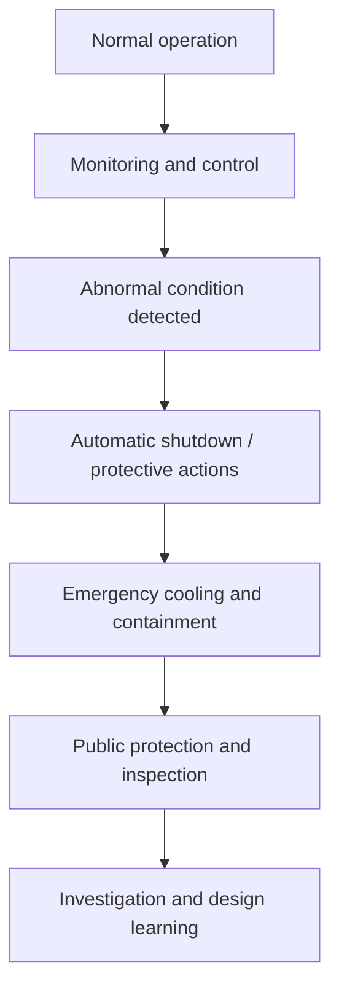

# Safety and Regulation

Safety and regulation are the defining discipline of nuclear engineering. The field is not only about producing power; it is about controlling hazards, preventing accidents, and maintaining public confidence in highly complex engineered systems.

## Core principles

### Defense in depth

Multiple layers of protection are designed to prevent and mitigate accidents. These include:

- prevention
- control and monitoring
- redundancy
- containment
- emergency response

### Risk-informed design

Nuclear safety relies on rigorous analysis of failure modes, consequences, and uncertainty. This includes:

- fault trees
- event trees
- probabilistic risk assessment (PRA)
- transient and accident analysis

### Licensing and oversight

Operators are regulated through licensing, inspections, reporting obligations, and enforcement. This ensures design margins and operational discipline remain within acceptable limits.

## Safety flow

## Major safety domains

- reactor protection systems
- emergency core cooling systems
- containment integrity
- severe accident mitigation
- radioactive release prevention
- fire and flood protection

## Reference links

- [Nuclear Regulatory Commission](https://www.nrc.gov/)
- [IAEA Safety Standards](https://www-ns.iaea.org/standards/)
- [OECD/NEA Safety and Regulation](https://www.oecd-nea.org/jcms/pl_22811/safety-and-regulation)

## Summary

Safety is not an add-on to nuclear engineering; it is part of the design philosophy. The discipline exists to ensure that the enormous benefits of nuclear technology are pursued with strict control over uncertainty and consequence.
