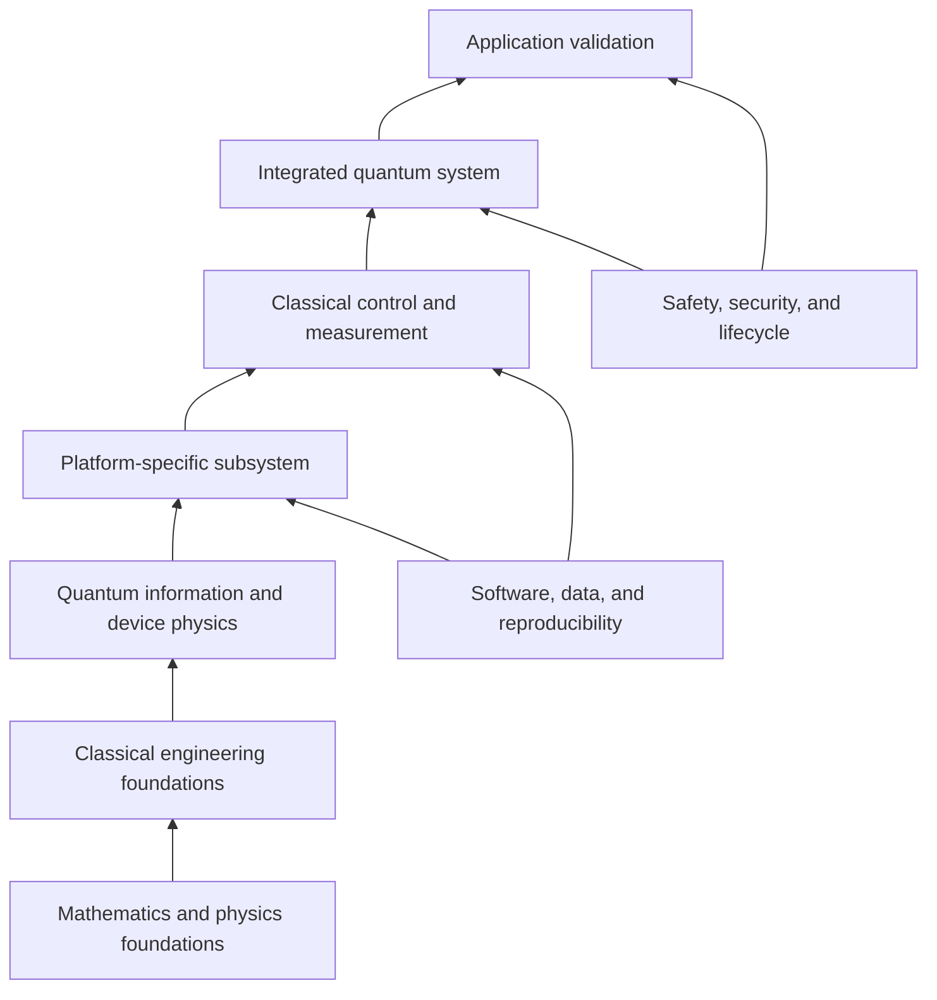

# Quantum Engineering Foundations and Integration Roadmap

Quantum engineering projects succeed through integration across a complete system, not by optimizing a quantum component in isolation. This guide shows how to build from established engineering disciplines, define the interfaces between them, and progress from fundamentals to a validated prototype.

## 1. Start with the task, not the platform

Define what needs to be measured, computed, communicated, or controlled before selecting a quantum technology. Record:

- the user or scientific need and the system boundary
- what a conventional system does today and where it falls short
- measurable performance targets and acceptable uncertainty
- operating environment, scale, duty cycle, and lifetime
- safety, privacy, cybersecurity, maintainability, and regulatory constraints
- what evidence would demonstrate that the integrated system meets its need

A quantum implementation is not automatically superior. For computation and optimization, use a competitive classical baseline. For sensing, compare against an appropriate conventional instrument. For networking, evaluate the complete link and key-management architecture rather than a photon source or protocol in isolation.

## 2. Build the prerequisite stack

### Shared foundations

- Mathematics: linear algebra, complex numbers, probability, statistics, differential equations, optimization, and numerical analysis.
- Physics: mechanics, electromagnetism, waves, thermal physics, solid-state concepts, and introductory quantum mechanics.
- Computing: programming, algorithms, version control, scientific computing, data handling, and reproducible workflows.
- Measurement: calibration, uncertainty, noise, sampling, signal processing, and experimental design.

### Engineering anchors

Choose one primary engineering anchor, then deliberately build the adjacent skills needed to integrate a system:

| Anchor | Build from | Quantum engineering extension |
| --- | --- | --- |
| Device and control | [Electrical Engineering](../Electrical/README.md): circuits, electronics, communications, controls, instrumentation | Low-noise control, pulse generation, readout, feedback, and calibration |
| Materials and fabrication | [Materials Engineering](../Materials/README.md): structure, processing, characterization, and reliability | Qubit/sensor materials, substrates, photonic structures, interfaces, and process yield |
| Mechanical and environment | [Mechanical Engineering](../Mechanical/README.md): dynamics, structures, manufacturing, and thermal systems | Cryogenic or vacuum packaging, vibration isolation, thermal design, precision alignment, and serviceability |
| Computing and networks | [Network Engineering](../Network/README.md): classical protocols, communications, distributed systems, and operations | Quantum circuit workflows, hybrid compute, synchronized nodes, classical side channels, and quantum-link orchestration |
| Automation and robotics | [Robotics Engineering](../Robotics/README.md): sensing, actuation, embedded control, and autonomous workflows | Automated alignment, repeatable experiments, laboratory orchestration, and safe interlocks |
| Biomedical applications | [Medical Engineering](../Medical/README.md): instrumentation, imaging, clinical context, and data governance | Quantum-enabled research prototypes, biomedical measurement, workflow integration, and evidence generation |

## 3. Think in layers and specify interfaces

A practical quantum platform usually includes several coupled layers:

1. **Quantum element:** qubit, photon source/detector, spin system, atomic ensemble, or quantum-sensitive measurement element.
2. **Physical environment:** temperature, vacuum, magnetic/electric fields, optical path, shielding, vibration, and packaging.
3. **Control and readout:** analog/RF or optical signals, timing, digitization, feedback, and calibration.
4. **Classical compute and data:** experiment control, compilation, signal processing, error analysis, storage, and model evaluation.
5. **Connectivity and operations:** synchronization, user access, monitoring, network boundaries, key management where applicable, and maintenance.
6. **Application and evidence:** task-specific performance, baseline comparison, human workflow, risk assessment, and intended-use limits.

Document an interface contract for each boundary. It should specify physical units and ranges, timing and synchronization assumptions, data formats, control authority, error behavior, calibration ownership, security boundaries, and acceptance tests. Changes in one layer can affect the others: for example, cabling or packaging can alter microwave loss, optical alignment, thermal load, or measured noise.

## 4. Integration pathways

### Quantum computing platform

Connect a processor to the control stack, compiler/runtime, measurement pipeline, and application workload. Track gate and readout behavior, calibration drift, circuit depth, shot count, queue and execution time, data-loading cost, and classical post-processing. Validate the workflow in simulation and compare the complete quantum or hybrid path with an appropriate classical method.

### Quantum network node

Integrate a photon or entanglement source, optical path, detectors, timing references, classical coordination channel, post-processing, and key or state management. Measure end-to-end loss, detection rate, synchronization error, quantum bit error rate where relevant, availability, and trust assumptions. Keep quantum key distribution distinct from post-quantum cryptography: one uses quantum communication protocols; the other uses conventional algorithms designed to resist attacks by quantum computers.

Continue with [Quantum Networks](Network/index.md), then connect the design to the broader [Network Engineering](../Network/README.md) discipline.

### Quantum sensing instrument

Treat the quantum-sensitive element as part of a calibrated instrument. Integrate it with excitation or preparation, environmental control, readout electronics, a stable reference, signal processing, and calibration procedures. Report sensitivity together with bandwidth, dynamic range, uncertainty, drift, operating conditions, and comparison to a conventional sensor.

### Medical or biomedical research system

Start from a clearly scoped research question and intended use. Integrate the quantum or hybrid method with validated data acquisition, a strong classical baseline, patient- or subject-level data separation, privacy and governance, external validation, and clinical-domain review. Research prototypes must not be represented as diagnostic or treatment systems without the required evidence, authorization, and oversight.

Continue with [Quantum Medical Systems](Medical/index.md) and the broader [Medical Engineering](../Medical/README.md) pathway.

## Example project paths

These are learning sequences for scoped prototypes, not ready-to-deploy product designs. Each should begin in simulation or a supervised lab environment and use appropriate safety and access controls.

### Automated quantum-device calibration bench

1. Build circuit, signal, and feedback foundations with [Electrical Engineering](../Electrical/README.md).
2. Study relevant device materials and fabrication constraints with [Materials Engineering](../Materials/README.md).
3. Integrate instruments, control software, repeatable procedures, and interlocks using [Robotics Engineering](../Robotics/README.md).
4. Demonstrate repeatable measurement and calibration on an approved educational or research platform.

### Quantum communication node demonstrator

1. Learn photonics and communications foundations through Electrical Engineering.
2. Study classical addressing, timing, secure management, and observability through [Network Engineering](../Network/README.md).
3. Model link loss, synchronization, and protocol behavior before using physical components.
4. Report end-to-end measurements, classical-channel assumptions, and the distinction between QKD and post-quantum cryptography.

### Quantum sensing instrument

1. Define a measurable physical quantity and identify a conventional reference instrument.
2. Build instrumentation, noise, and calibration skills through Electrical Engineering.
3. Add materials, packaging, mechanical stability, and environmental controls appropriate to the sensor platform.
4. Characterize uncertainty, sensitivity, bandwidth, drift, and repeatability against the reference.

### Biomedical quantum-method research workflow

1. Frame a research question with a medical or biomedical domain partner and review data permissions.
2. Establish a classical baseline and reproducible data workflow using the [Quantum Medical Systems](Medical/index.md) guide.
3. Evaluate any quantum or hybrid method with subject-level data separation, external validation where available, and transparent limitations.
4. Keep research outputs distinct from clinical decision-making unless the applicable evidence and authorization requirements are met.

## 5. Prototype progression and acceptance evidence

| Stage | Engineering work | Evidence to retain |
| --- | --- | --- |
| Concept and requirements | Define task, system boundary, baseline, risks, and measurable targets | Requirements, assumptions, use limits, and decision criteria |
| Simulation | Model candidate algorithms, device behavior, noise, or communication link | Versioned model, parameters, limitations, and reproducible results |
| Subsystem bench test | Characterize a control, material, detector, sensor, or compute module | Calibration records, uncertainty, noise, repeatability, and interface measurements |
| Integrated prototype | Connect quantum and classical subsystems using controlled interfaces | System diagram, interface tests, logs, configuration, and failure behavior |
| Context testing | Evaluate realistic environmental, network, user, or application conditions | Stress results, drift, safety/security review, and baseline comparison |
| Independent validation | Reproduce results and review methods and claims | External review, versioned data/code where permitted, and clear limitations |

Move forward only when acceptance criteria for the current stage are met. If a quantum prototype does not outperform or otherwise improve on a conventional approach for the intended task, that is a useful engineering result; document it and revisit the system requirements.

## 6. Integration review checklist

- Are system boundaries, owners, requirements, and failure consequences documented?
- Is there a credible conventional baseline and a fair comparison plan?
- Are material, thermal, mechanical, electrical, optical, timing, and data interfaces specified?
- Are calibration, drift, uncertainty, noise, repeatability, and failure modes measured?
- Are software, firmware, datasets, configurations, and experiment parameters versioned?
- Are access control, network segmentation, data governance, and recovery planned?
- Are safety functions, interlocks, operating limits, and maintenance procedures reviewed?
- Are claims matched to evidence, and are research, operational, and clinical uses clearly distinguished?

## Selected ecosystem references

- [NIST Quantum Information Science](https://www.nist.gov/quantum-information-science)
- [Quantum Economic Development Consortium](https://quantumconsortium.org/)
- [ETSI Quantum Key Distribution](https://www.etsi.org/technologies/quantum-key-distribution)
- [NIST Post-Quantum Cryptography](https://csrc.nist.gov/projects/post-quantum-cryptography)
- [Quantum Medical Systems](Medical/index.md)
- [Quantum Networks](Network/index.md)

## Summary

A useful quantum engineering path starts with an application and grows through measured interfaces: physics to materials, devices to control, control to classical computing and networks, and integrated systems to independent validation. Building from established engineering disciplines makes quantum work more reproducible, maintainable, and honest about where it helps.