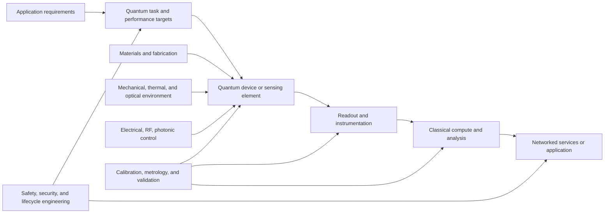

# Quantum Engineering

Quantum engineering turns quantum science into devices, computing systems, communication links, sensors, and validated applications. It is inherently interdisciplinary: useful quantum systems depend on classical electronics and control, specialized materials and fabrication, mechanical and thermal design, software and networking, and careful application-level validation.

This index is organized around both the technical fields and the engineering disciplines they build on. Start with the shared foundations, follow an integration path, then use the field guides for deeper study.

## Navigation

- [Quantum Medical Systems](Medical/index.md): quantum applications in medical engineering and health informatics
- [Quantum Networks](Network/index.md): quantum networking, protocols, and communications resources
- [Foundations and Integration Roadmap](foundations-and-integration.md): prerequisites, engineering interfaces, system lifecycle, and example project paths

## Related engineering domains

Quantum engineering builds on established disciplines. Use these hubs for the underlying methods and infrastructure; the Quantum guides focus on how those capabilities combine in quantum-specific systems.

- [Electrical Engineering](../Electrical/README.md): circuits, electronics, communications, control, and instrumentation for quantum devices
- [Materials Engineering](../Materials/README.md): device materials, substrates, fabrication, interfaces, and reliability
- [Mechanical Engineering](../Mechanical/README.md): cryogenic and vacuum systems, thermal design, vibration isolation, packaging, and alignment
- [Network Engineering](../Network/README.md): classical connectivity, distributed systems, timing, security boundaries, and operations
- [Robotics Engineering](../Robotics/README.md): laboratory automation, sensing, actuation, and repeatable experimental workflows
- [Medical Engineering](../Medical/README.md): biomedical instrumentation, clinical context, health data, and evidence requirements
- [Nuclear Engineering](../Nuclear/README.md): radiation environments, nuclear measurements, shielding, and high-reliability systems

## Major quantum engineering fields

### Quantum computing and information processing

This field develops quantum processors and the algorithms, control software, and classical infrastructure needed to use them. Engineering work spans qubit implementation, gate and measurement operations, calibration, error characterization, compilation, hybrid workflows, and the classical comparison needed to establish whether a quantum method is useful.

Builds on: linear algebra, probability, algorithms, classical computing, electronics, microwave or optical engineering, control systems, and materials science.

### Quantum hardware, devices, and control

Quantum hardware converts a physical platform into controllable quantum degrees of freedom. Platforms can include superconducting circuits, trapped ions, neutral atoms, spins in solid-state materials, and photonic devices. Each platform has different fabrication, packaging, environmental, control, readout, and scaling requirements.

Builds on: electrical engineering, electronics, RF and microwave systems, photonics, instrumentation, materials engineering, mechanical design, thermal engineering, vacuum systems, and precision manufacturing.

### Quantum communication and networking

Quantum communication studies how quantum states or quantum-derived resources are distributed between nodes. Current engineering includes quantum key distribution, entanglement distribution experiments, quantum memories, trusted or untrusted nodes, and the classical channels required for coordination and post-processing. Quantum networking is not simply conventional networking with quantum encryption; it introduces distinct state-preparation, measurement, loss, synchronization, and trust constraints.

Builds on: optical communications, photonics, network engineering, timing and synchronization, classical cryptography, distributed systems, and secure operations. See [Quantum Networks](Network/index.md).

### Quantum sensing and metrology

Quantum sensors use carefully prepared quantum systems to measure quantities such as time, magnetic or electric fields, acceleration, rotation, and temperature. Engineering a useful sensor requires a complete measurement chain, not just a quantum-sensitive element: packaging, environmental control, calibration, signal processing, reference systems, and comparison with conventional instruments all matter.

Builds on: electrical and instrumentation engineering, optics, materials, mechanical systems, signal processing, control, metrology, and application-specific science.

### Quantum-enabled application engineering

Applications connect a quantum device or computation to a real user need. They may involve chemistry and materials discovery, optimization, secure communications, navigation, medical imaging, or biomedical analysis. The application must be formulated so that data access, input encoding, output interpretation, resource requirements, and evaluation are all explicit.

Builds on: the target application domain, software engineering, data engineering, classical modeling, measurement science, and domain-specific safety or regulatory practice. See [Quantum Medical Systems](Medical/index.md) for the health and biomedical pathway.

## Integration across engineering domains

Quantum systems are hybrid systems: the quantum device is surrounded by classical components that prepare, control, measure, protect, and interpret it.

| Engineering domain | Contribution to quantum systems | Typical interface to define |
| --- | --- | --- |
| [Electrical Engineering](../Electrical/README.md) | Low-noise electronics, RF/microwave and optical control, power, grounding, readout, feedback, and instrumentation | Signal levels, bandwidth, noise, timing, grounding, control protocol, and calibration |
| [Materials Engineering](../Materials/README.md) | Qubit and sensor materials, substrates, photonic structures, packaging, coatings, and process characterization | Composition, defects, fabrication tolerances, interfaces, thermal properties, and yield |
| [Mechanical Engineering](../Mechanical/README.md) | Cryogenic and vacuum enclosures, vibration isolation, thermal management, alignment, packaging, and serviceability | Heat load, vibration, pressure, dimensions, materials compatibility, and maintenance access |
| [Network Engineering](../Network/README.md) | Classical control and data networks, timing, distributed services, and communications infrastructure around quantum links | Latency, synchronization, availability, trust boundaries, key or state handling, and classical side channels |
| [Robotics Engineering](../Robotics/README.md) | Automated laboratory handling, alignment, calibration routines, inspection, and experiments that combine sensing with actuation | Coordinate frames, feedback rates, interlocks, repeatability, and operator authority |
| [Medical Engineering](../Medical/README.md) | Biomedical instrumentation, imaging, clinical workflows, data governance, and evaluation of health applications | Intended use, workflow, measurement validity, privacy, risk, and evidence requirements |
| [Nuclear Engineering](../Nuclear/README.md) | Radiation environments, nuclear measurement contexts, shielding, and high-reliability instrumentation where relevant | Radiation tolerance, measurement chain, shielding, safety case, and environmental qualification |

## End-to-end engineering lifecycle

1. Define the application need and compare it with a conventional engineering solution.
2. Translate the need into measurable requirements: sensitivity, fidelity, throughput, latency, operating time, environment, size, cost, and reliability.
3. Select a physical platform and identify its dependencies on materials, fabrication, temperature, vacuum, fields, optics, and control electronics.
4. Design the classical support system: control, readout, calibration, timing, compute, storage, and network interfaces.
5. Integrate modules against documented interface budgets and verify each subsystem before full-system operation.
6. Characterize the device and measurement chain, including noise, drift, error, repeatability, and operating limits.
7. Compare performance against an appropriate classical baseline and account for data loading, error correction or mitigation, runtime, and total system resources.
8. Document reproducibility, cybersecurity, safety, maintainability, and limitations before proposing operational or clinical use.

## Suggested learning sequence

### Shared foundations

- linear algebra, complex numbers, probability, statistics, and numerical methods
- classical mechanics, electromagnetism, waves, and introductory quantum mechanics
- circuits, electronics, signals, feedback control, and measurement uncertainty
- programming, algorithms, version control, data handling, and reproducible experiments

### Choose an engineering anchor

- **Device and control route:** electronics and control, then quantum hardware, readout, packaging, and calibration
- **Materials route:** solid-state physics and materials characterization, then fabrication and quantum device interfaces
- **Photonics and networking route:** optics and communications, then quantum communication components and network integration
- **Computing route:** algorithms and systems, then quantum circuits, compilation, hybrid computation, and benchmarking
- **Sensing route:** instrumentation and metrology, then quantum-sensitive elements, calibration, and application validation
- **Medical route:** biomedical instrumentation and data governance, then quantum research workflows and clinical evidence requirements

### Integrate and specialize

Build a subsystem, measure its real behavior, and connect it to the neighboring engineering layer. A useful progression is simulation, benchtop subsystem, integrated prototype, environmental or user-context testing, and independent validation. Move to a more complex quantum platform only when the previous stage has measurable and reproducible results.

## Standards and ecosystem references

- [NIST Quantum Information Science](https://www.nist.gov/quantum-information-science): research programs, measurement, and technology context
- [National Quantum Initiative](https://www.quantum.gov/): United States program and ecosystem information
- [Quantum Economic Development Consortium](https://quantumconsortium.org/): industry collaboration and workforce resources
- [ETSI Quantum Key Distribution](https://www.etsi.org/technologies/quantum-key-distribution): QKD standardization activities
- [NIST Post-Quantum Cryptography](https://csrc.nist.gov/projects/post-quantum-cryptography): conventional cryptography designed to resist quantum-computer attacks; distinct from QKD and quantum networking

Standards and regulatory requirements are technology-, application-, and jurisdiction-specific. Treat the links as starting points, confirm current editions, and do not assume that a research demonstration is certified for operational, security-critical, or clinical use.

## Engineering principle

Quantum engineering is successful when the complete system performs a defined task reliably and measurably, not merely when an isolated quantum effect is observed. The discipline grows by connecting physics to materials, devices, controls, classical infrastructure, networks, and real application requirements.