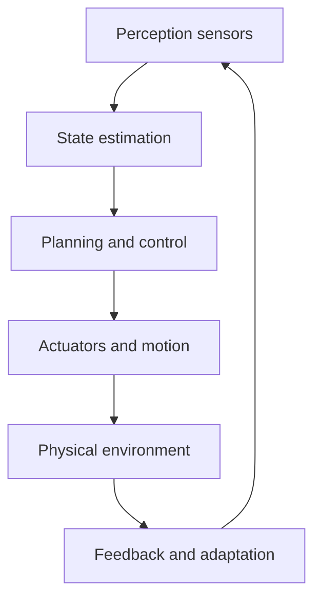

# Robotics Engineering

Robotics engineering is the discipline of designing systems that sense, reason, act, and interact with the physical world. It integrates mechanics, electronics, control systems, computation, and perception to produce autonomous or semi-autonomous machines.

This section sits at the crossroads of electrical engineering, mechanical design, AI, sensing, and application systems. It is best understood as an integration field rather than a single narrow specialty.

## Core themes

- perception and sensing
- planning and decision-making
- motion control and actuation
- embedded systems and hardware interfaces
- human-robot interaction
- autonomy and intelligent behavior

## Related domains

- [Electrical Engineering](../Electrical/README.md): power, sensing, embedded electronics, and control hardware
- [Mechanical Engineering](../Mechanical/README.md): dynamics, structures, motion, and actuation systems
- [Network Engineering](../Network/README.md): connectivity, telemetry, coordination, and distributed robot systems
- [Medical Engineering](../Medical/README.md): assistive, rehabilitative, and surgical robotics

## Learning path

### Foundations

- kinematics and dynamics
- controls and feedback
- electronics and embedded systems
- machine vision and perception

### Applied robotics

- mobile robots and navigation
- manipulation and grasping
- localization and mapping
- safety, human factors, and design constraints

### Advanced topics

- reinforcement learning and autonomy
- multi-robot coordination
- edge AI and embedded intelligence
- industrial, service, and field robotics

## Robot system overview

## Resources

- [Introduction to Robotics](https://www.youtube.com/watch?v=b5C9SPVlU4U)
- [SI4735 Ard Lib](https://github.com/pu2clr/SI4735)
- [DRA818V module references](https://www.aliexpress.com/w/wholesale-dra818v.html)

## Research hubs and journals

- [Google Scholar](https://scholar.google.com/)
- [Google Research](https://research.google/)
- [SciX](https://scix.org/)
- [IEEE Xplore](https://ieeexplore.ieee.org/)
- [IEEE Transactions on Robotics](https://ieeexplore.ieee.org/xpl/RecentIssue.jsp?punumber=100)
- [International Journal of Robotics Research](https://journals.sagepub.com/home/ijr)
- [Autonomous Robots](https://link.springer.com/journal/10514)
- [Science Robotics](https://www.science.org/journal/scirobotics)
- [IEEE Robotics and Automation Letters](https://ieeexplore.ieee.org/xpl/RecentIssue.jsp?punumber=7083369)
- [Harvard Dataverse](https://dataverse.harvard.edu/)
- [Dryad](https://datadryad.org/)
- [arXiv](https://arxiv.org/)

## Licenses, certifications, and compliance standards

- [ISO 10218 Industrial Robots Safety](https://www.iso.org/standard/41543.html)
- [ISO 13855 Safety Distances](https://www.iso.org/standard/69011.html)
- [IEC 61508 Functional Safety of Electrical/Electronic/Programmable Systems](https://webstore.iec.ch/publication/5515)
- [IEC 60204 Electrical Equipment of Machines](https://webstore.iec.ch/publication/15233)
- [ANSI/RIA R15.08 Robot Safety](https://www.robotics.org/)
- [NFPA 79 Electrical Standard for Industrial Machinery](https://www.nfpa.org/codes-and-standards/all-codes-and-standards/list-of-codes-and-standards/detail?code=79)
- [IEEE Standards](https://standards.ieee.org/)
- [OSHA Robotics and Machine Safety Guidance](https://www.osha.gov/)

## Summary

Robotics engineering is the integration of electrical, mechanical, computational, and systems thinking into machines that act in the real world. It is one of the clearest examples of how the engineering domains work together as a single connected discipline.
