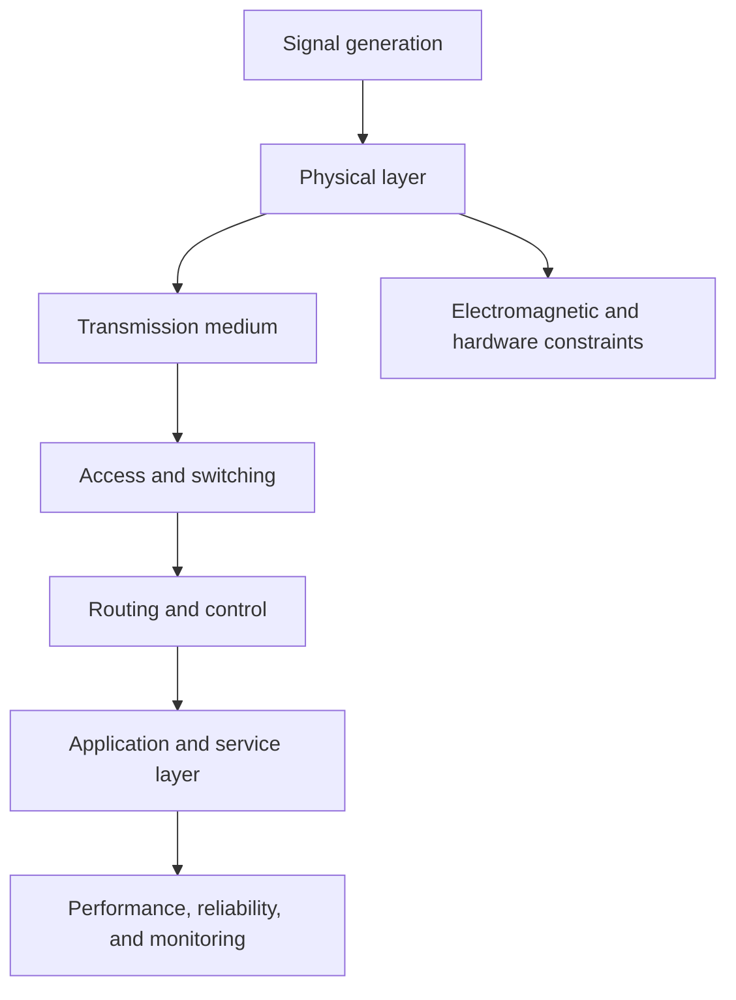

# Network Engineering

Network engineering is the discipline concerned with how information is transmitted, switched, routed, and managed across systems. It builds directly on electrical engineering foundations such as signal propagation, electromagnetic behavior, modulation, transmission media, and communications hardware.

This section is designed to work alongside the electrical engineering track rather than as a separate silo. Electrical engineering supplies the physical layer and device-level foundations; network engineering focuses on architecture, traffic flow, protocols, reliability, and system-level connectivity.

## Core themes

- communications systems and signal transport
- network architecture and topology
- wireless systems, spectrum, and propagation
- switching, routing, and protocol stacks
- reliability, latency, and capacity planning
- next-generation network design and intelligent infrastructure

## Related domains

- [Electrical Engineering](../Electrical/README.md): power, circuits, signals, electromagnetics, electronics, and control foundations
- [Communications](../Electrical/communications.md): modulation, signal flow, noise, bandwidth, and communications theory
- [Signals and Systems](../Electrical/signals-and-systems.md): time-domain and frequency-domain analysis

## Learning path

### Foundations

- circuit and signal fundamentals
- electromagnetic wave propagation
- channel capacity and noise
- modulation and coding

### System design

- network topologies and traffic models
- routing, switching, and latency management
- wireless access and spectrum planning
- network performance and resilience

### Advanced topics

- 5G/6G and next-generation wireless systems
- edge and distributed network architectures
- Internet-scale systems and network optimization
- intelligent network management and automation

## Network system overview

## Research hubs and journals

- [Google Scholar](https://scholar.google.com/)
- [Google Research](https://research.google/)
- [IEEE Xplore](https://ieeexplore.ieee.org/)
- [IEEE/ACM Transactions on Networking](https://dl.acm.org/journal/ton)
- [IEEE Journal on Selected Areas in Communications](https://ieeexplore.ieee.org/xpl/RecentIssue.jsp?punumber=49)
- [IEEE Transactions on Wireless Communications](https://ieeexplore.ieee.org/xpl/RecentIssue.jsp?punumber=7693)
- [ACM SIGCOMM](https://dl.acm.org/sig/sigcomm)
- [Computer Networks](https://www.sciencedirect.com/journal/computer-networks)
- [Nature Communications](https://www.nature.com/ncomms/)
- [Harvard Dataverse](https://dataverse.harvard.edu/)
- [Dryad](https://datadryad.org/)
- [arXiv](https://arxiv.org/)

## Summary

Network engineering is the communication layer that turns electrical and signal-level phenomena into usable, connected systems. It complements electrical engineering by focusing on the structure, movement, and intelligence of digital communication across networks.