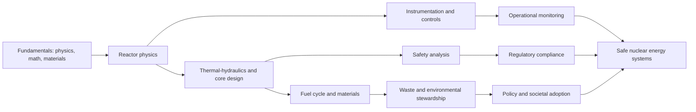
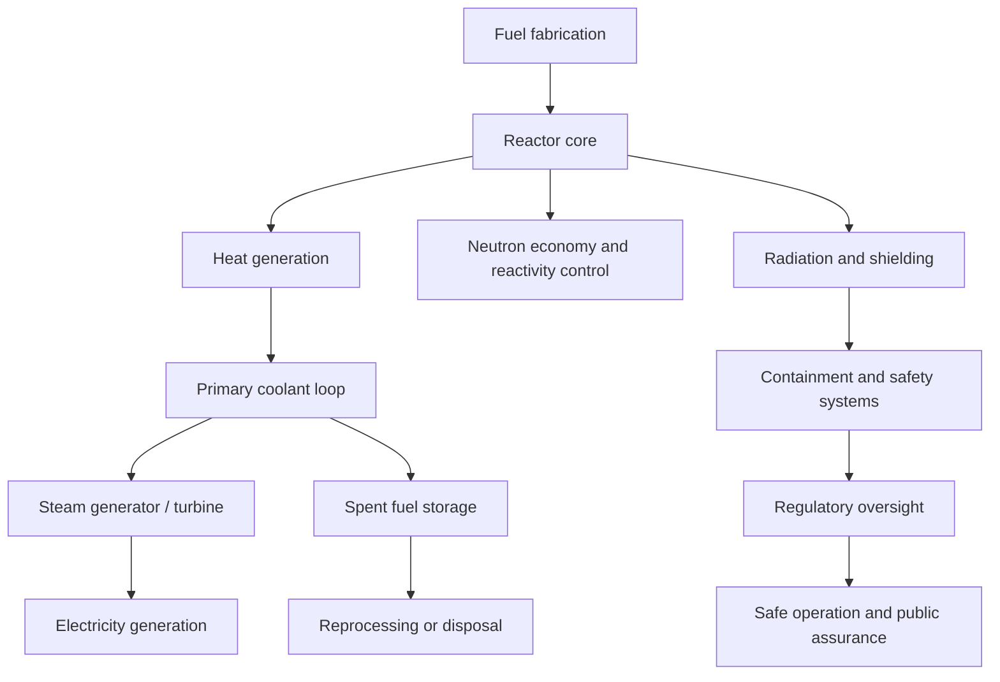

# Nuclear Engineering

Nuclear engineering applies principles from physics, materials, heat transfer, control systems, radiation science, and systems engineering to the safe and effective use of nuclear energy and radiation technologies. This section is organized as an Iseek-style knowledge hub: a gateway to education, research, technical methods, safety, and broader societal impacts.

## Purpose

This directory supports learning across four main layers:

1. foundational nuclear science
2. reactor physics and thermal-hydraulic systems
3. safety, regulation, and materials behavior
4. energy, policy, and research applications

The goal is to serve as both a discovery index and a study map for future detailed pages.

## Domain map

- [Reactor Systems](reactor-systems.md): reactor types, neutron behavior, core design, and thermal-hydraulic performance
- [Radiation Science](radiation-science.md): nuclear interactions, shielding, dosimetry, radiation transport, and biological effects
- [Fuel Cycle and Materials](fuel-cycle.md): fuel fabrication, reprocessing, waste management, and high-performance materials
- [Safety and Regulation](safety-and-regulation.md): accident analysis, defense-in-depth, licensing, and risk-informed decision making
- [Instrumentation and Controls](instrumentation-and-controls.md): sensors, reactor control, signal processing, and system monitoring
- [Nuclear Policy and Society](nuclear-policy.md): energy policy, public trust, security, ethics, and deployment strategy

## Core study flow

## Why this matters

Nuclear engineering matters because it addresses a uniquely difficult engineering problem: producing large amounts of energy and useful radiation while ensuring safety, reliability, and responsible stewardship of radioactive materials. The field sits at the intersection of:

- energy systems and grid stability
- advanced materials and corrosion science
- radiation protection and health physics
- systems engineering and controls
- policy, security, and public trust

## Education and research anchors

### Research and academic institutions

- [NC State Nuclear Engineering](https://ne.ncsu.edu/)
  - [Undergraduate](https://ne.ncsu.edu/undergraduate/)
  - [Graduate](https://ne.ncsu.edu/graduate/)

### Reference organizations

- [Nuclear Regulatory Commission](https://www.nrc.gov/)
- [International Atomic Energy Agency](https://www.iaea.org/)
- [World Nuclear Association](https://world-nuclear.org/)
- [U.S. Department of Energy - Nuclear Energy](https://www.energy.gov/ne/nuclear-energy)

### Technical foundations

- [MIT OpenCourseWare - Nuclear Engineering](https://ocw.mit.edu/search/?q=nuclear%20engineering)
- [NEA Nuclear Education and Training](https://www.oecd-nea.org/jcms/pl_40025/nuclear-education-and-training)

## Documentation outline

This section should be maintained as an index page for the following categories:

- foundational learning and theory
- reactor design and operation
- radiation science and protection
- fuel cycle and waste management
- safety and licensing
- instrumentation and controls
- societal, strategic, and policy context

## Nuclear energy system overview

## Suggested learning sequence

### Beginner

- atomic structure and radioactivity
- neutron interactions and cross sections
- reactor basics and core concepts
- safety principles and radiation protection

### Intermediate

- heat transfer and thermal hydraulics
- neutron transport and diffusion
- fuel behavior and materials degradation
- plant transient analysis

### Advanced

- reactor physics and core design
- accident analysis and severe conditions
- probabilistic risk assessment
- fuel cycle optimization and environmental stewardship

## Summary

Nuclear engineering is a systems-heavy discipline that integrates advanced physics, thermal science, materials, controls, and policy. This index is intended to guide a learner from the fundamentals of radiation and reactors to the broader realities of safe, reliable, and socially accountable nuclear technology.